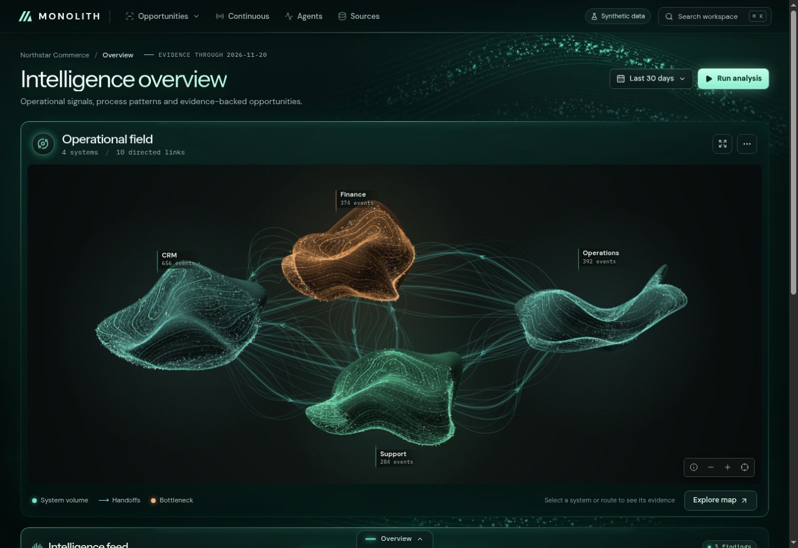
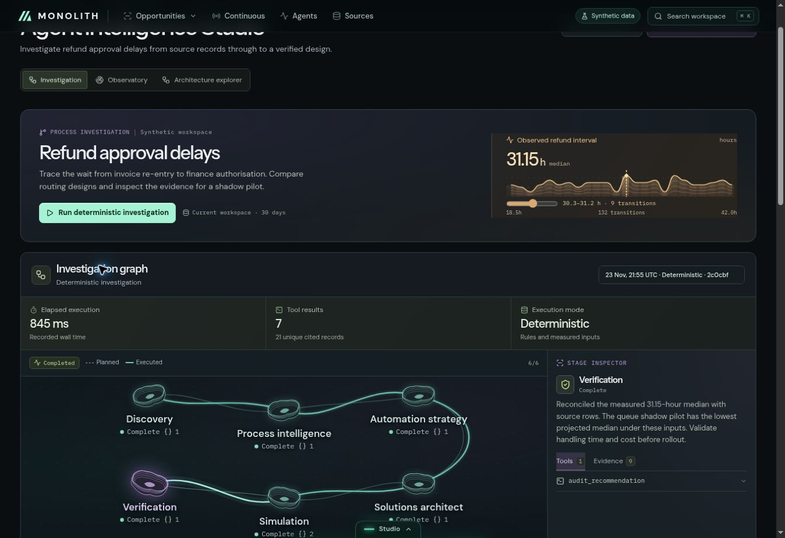
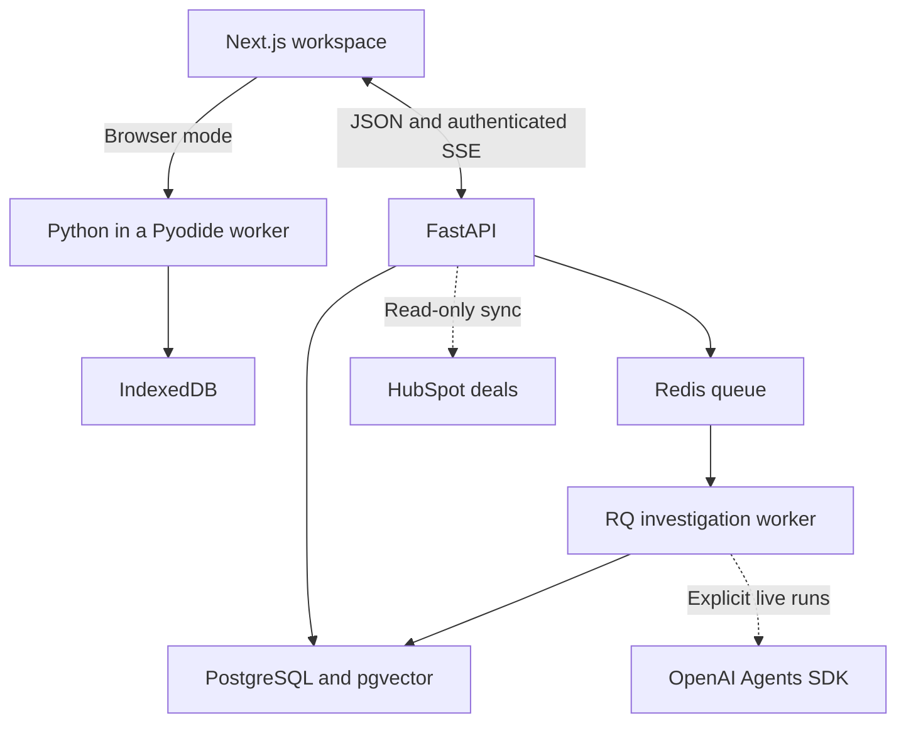

# MONOLITH

### Operational intelligence · Process discovery · Evidence-backed automation design

**Find the bottleneck. Inspect the evidence. Compare the intervention. Engineer the next step.**

MONOLITH reconstructs business processes from the records that systems leave behind. It connects process discovery, six-stage investigations, scenario simulation and human-approved implementation blueprints in one inspectable workspace. Every measured delay can be traced to source events; every projected improvement exposes its assumptions.

**Next.js / React / TypeScript · Python / FastAPI · PostgreSQL / pgvector · Redis / RQ · Pyodide · OpenAI Agents SDK**

[Live workspace](https://monolith.digitalprodigy.dev/) · [Reviewer guide](docs/reviewer-guide.md) · [Screenshots](docs/screenshots/README.md) · [Engineering overview](docs/engineering-overview.md) · [Run locally](#run-the-demo) · [Evaluation and release evidence](docs/release/readiness.md)



*Actual screenshot from [monolith.digitalprodigy.dev](https://monolith.digitalprodigy.dev/). The redesigned operational field visualises four systems and their handoffs in the synthetic Northstar workspace.*

> Northstar Commerce is synthetic. Its elapsed times are measured from source events. Routing outcomes are simulations. The six-stage staging investigation used deterministic analysis and made zero model calls. Refund authorisation and dispute decisions stay with people.

## What makes the system substantive

| Engineering problem | Implemented approach |
| --- | --- |
| Business records span systems and formats | Canonical case events, CSV/API ingestion, PDF page evidence, stable identifiers and duplicate/conflict handling. |
| A headline metric does not establish a cause | Case-level timelines, process variants, observed handoffs and source-linked interval calculations. |
| An investigation needs inspectable execution | Six ordered stages, typed findings, tool receipts, citations, recorded handoffs and replay on frozen inputs. |
| A proposed automation needs explicit trade-offs | Per-case simulation, competing routing designs, editable coverage/failure assumptions and objective comparison. |
| A plausible recommendation can still be wrong | Independent source checks, disagreement inspection, design vetoes and human approval boundaries. |
| A worker or connection can fail mid-run | Persisted execution, worker leases, bounded retries, immutable snapshots and cursor-based event recovery. |

### Inside the workspace



*The current Studio shows six completed stages, seven tool results and 21 unique cited records from a deterministic investigation. The graph and stage inspector expose the recorded execution and its evidence.*

[View the current screenshot gallery →](docs/screenshots/README.md) · [Open the live workspace →](https://monolith.digitalprodigy.dev/)

## Start with the Northstar refund investigation

The 30-day Northstar export contains **1,706 events across 328 linked cases and five process variants**. In 132 refund cases, the median time from invoice re-entry to finance authorisation was **31.15 hours**. That interval tells you where to look. The source records alone cannot tell you how much of the wait an automation would remove.

1. From **Overview → Intelligence feed**, select **Open investigation**, or open **Studio → Run deterministic investigation**. In Agent Intelligence Studio, follow discovery, process analysis, automation strategy, architecture, simulation and verification. Select a tool result to read the source rows or policy page behind a finding.
2. Compare the **event-driven queue** with the **scheduled digest**. At the default assumptions, their projected median intervals are **22.34 hours** and **26.55 hours**. Change the routing coverage or exception delay in **Scenario** to see which assumptions drive the difference. The 66 dispute reviews remain human-led.
3. Open **Observatory → Evaluation** to inspect the evidence checks and disagreements. A person can approve an eligible design, then export its **Technical blueprint** with the data contract, failure recovery, rollout and acceptance criteria. Approval records a design decision inside MONOLITH.

The saved staging run includes six completed stages, five handoffs and seven tool results. Its eight findings cite 21 distinct evidence records. Independent replay recorded 40 passing checks, two requiring review and one disagreement. The design was awaiting human approval when the receipt was captured. [Staging investigation receipt](docs/release/evidence/staging-investigation.json)

## What is implemented

| Area | What you can inspect |
| --- | --- |
| Ingestion and provenance | Import case events from CSV, policy pages from text PDFs, or event batches through the authenticated API. Follow an observation to its source row or page. Imports distinguish duplicates from conflicting updates. |
| Process discovery and Business Map | Reconstruct case timelines, variants, directly-following activities and weighted system handoffs. Select an entity, link or historical revision to inspect the evidence and distinguish observed traffic from inferred ownership. |
| Continuous Intelligence | Compare adjacent seven-day windows for latency, changing paths, repeated work and handoffs. Load the synthetic backlog and recovery streams to see the refund median move from 31.02 to 70.33 to 25.20 hours across those cohorts. Decision memory retains the earlier recommendation and its reassessment. |
| Studio and Observatory | Inspect ordered execution events, specialist tools, citations, competing proposals and verification results. Replay a run, compare frozen inputs across runs and inspect available model usage, timing and cost receipts. |
| Simulation and blueprints | Recalculate each case under explicit scenarios, inspect sensitivity to assumptions, and trace an approved design to its evidence. Vetoes and human approval constrain which design advances. |
| Workspace controls and recovery | Named roles scope ingestion, evidence, execution and approval by tenant. Immutable inputs, worker leases, bounded retries and cursor-based event streams support recovery and inspection. |

## Architecture

The browser showcase and persistent API deployment share portable Python analysis. The browser path executes in a dedicated WebAssembly worker; the backend path adds tenant-scoped persistence, authenticated streaming and recoverable background execution. Live model execution is an explicit opt-in path, not a requirement for the synthetic demonstration. [Execution boundaries and source map](docs/engineering-overview.md).



| Source | Responsibility |
| --- | --- |
| [apps/web](apps/web) | Next.js, React and TypeScript for nine workspace views. The operational field projects data-driven surfaces onto Canvas 2D. The browser worker runs the portable Python analysis. |
| [apps/api/monolith](apps/api/monolith) | FastAPI, SQLAlchemy, ingestion adapters, process discovery with PM4Py checks, simulation, evaluation and background workers. Both runtimes share the portable analysis code. |
| [Database migrations](apps/api/migrations) | Versioned PostgreSQL schema and vector storage. SQLite supports single-machine API development. |
| [Deployment](deploy) and [workflows](.github/workflows) | Caddy gateway, container builds, verification, promotion, backup and recovery. |
| [Backend tests](apps/api/tests), [verification scripts](scripts) and [release receipts](docs/release) | Executable checks and the recorded scope of staging acceptance. |

## Run the demo

Use Node.js 22.13+ and npm. Node 24 was used for verification. From the repository root:

```sh
npm ci
npm run prepare:runtime
npm run dev:web
```

Open [localhost:3000](http://localhost:3000). **Agent Intelligence Studio → 90-second walkthrough** guides you from a source record to a blueprint. The standalone workspace starts with the bundled Northstar analysis. Further analysis runs locally in WebAssembly and persists in the current browser profile. The demo requires no account or provider key.

## Run a backend-connected workspace

For local development, install Python 3.12 or 3.13 and [uv](https://docs.astral.sh/uv/). Start FastAPI in one terminal:

```sh
cd apps/api
uv sync --frozen
uv run uvicorn monolith.main:app --host 127.0.0.1 --port 8000
```

In another terminal, run the following from the repository root after installing and preparing the frontend:

```sh
NEXT_PUBLIC_API_URL=http://127.0.0.1:8000 npm run dev:web
```

This configuration uses SQLite and local job execution. An already-running frontend can connect from **Data sources → Investigation runtime → Connect API**. Browser and server workspaces retain their own records. [Local API reference](http://127.0.0.1:8000/docs)

**PostgreSQL and background workers.** For a fresh local Compose install, copy the environment example and set `DB_PASSWORD` in the private copy to a random URL-safe value.

```sh
cp .env.example .env
chmod 600 .env
# Set DB_PASSWORD in .env before starting the services.
docker compose up -d --build
```

The base stack runs PostgreSQL 17 with pgvector, Redis, FastAPI and an RQ worker. Start the frontend separately with the same loopback API URL above. Keep `MONOLITH_MODEL_CALLS_ENABLED=0` for deterministic operation. Configure `TENANT_IDENTITIES` and exact `WEB_ORIGINS` for authenticated workspaces. Provider keys, OAuth tokens, encryption keys and workspace credential mappings belong on the server. [Environment example](.env.example) · [Identity and workspace roles](docs/workspace-access.md)

## Verification and acceptance

| Execution path | Available evidence |
| --- | --- |
| Deterministic analysis | Real process discovery, evidence retrieval and simulation over synthetic Northstar records. An RQ investigation completed all six stages in staging. |
| Controlled providers | Tests run the OpenAI SDK over a controlled HTTP transport and exercise HubSpot OAuth, refresh, pagination, checkpointing and tenant isolation with controlled responses. |
| Live OpenAI | The server supports opt-in live runs, bounded usage and receipt verification. An official six-specialist run and an approved live replay archive are outstanding. |
| Live HubSpot | The read-only deal connector is implemented. Consent, incremental synchronisation and revocation on a real sandbox portal are outstanding. |
| Hosting | The browser showcase and persistent workspace staging are separate profiles. Permanent hosting, public TLS, protected promotion, off-host recovery and production capacity checks remain open. |

To reproduce the main checks, install the locked frontend and Python dependencies as above. The browser regression uses a system Chromium executable. Set `CHROMIUM_PATH` if it is outside `/usr/bin/chromium`.

```sh
(cd apps/api && uv run --frozen pytest -q)
npm run build
npm run typecheck
node scripts/test-field-projection.mjs
npm run test:browser
```

For the wider application gates, run `python scripts/release-acceptance.py --existing-build --output /tmp/monolith-acceptance.json` with Docker and Chromium available. The published staging evidence covers 205 backend tests, the nine workspace views, browser-engine checks and automated accessibility checks. Hardware Safari, spoken screen-reader checks and host-level operational gates are tracked separately. [Acceptance matrix and receipts](docs/release/readiness.md) · [Operational field checks](docs/release/living-field.md)

## Deployment and engineering guides

`npm run build` exports the standalone frontend to `dist/`. For persistent deployment the same-origin gateway serves the frontend and authenticated API. Follow the host runbook for DNS, TLS, named credentials, storage, migrations and restore checks. [Hosting](docs/hosting-api.md) · [Production operations](docs/production-operations.md)

- [Ingestion contracts and HubSpot acceptance](docs/ingestion.md)
- [Investigation API, evaluation and verified replay export](docs/refund-investigation.md)
- [Model credentials, budgets and execution verification](docs/live-runtime.md)
- [Worker reliability and event recovery](docs/release/job-reliability.md)
- [Monitoring, retention and erasure](docs/release/operations.md)
- [Engineering case study source](apps/web/public/engineering-case-study/index.html)
