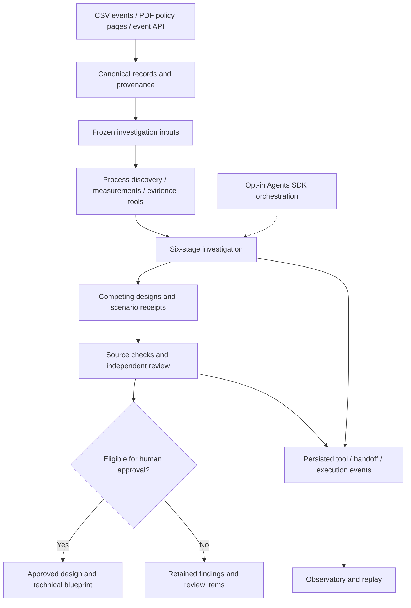

# Engineering overview

MONOLITH combines process analytics with bounded investigation orchestration. Its key contract is traceability: records establish measurements, measurements constrain proposals, and proposals remain subject to verification and human review.

## Two execution profiles, shared analysis

| Boundary | Browser showcase | Persistent backend |
| --- | --- | --- |
| Interface | Next.js, React and TypeScript | The same workspace connected to an authenticated API |
| Analysis | Python in a Pyodide worker; portable modules | Python services and the same portable analysis modules |
| State | Browser-scoped IndexedDB | Tenant-scoped SQLAlchemy storage; PostgreSQL/pgvector in the deployment stack |
| Execution | Deterministic investigations over synthetic records | Local or Redis/RQ execution; explicitly enabled live provider runs |
| Inspection | Sources, stage results, scenarios and recorded replay | Persisted events, SSE cursors, frozen inputs, recovery and approval records |

### Evidence and execution boundaries

The deterministic tools perform the calculations in both investigation modes. The live path adds model interpretation and structured proposals; tool receipts and source checks constrain what can advance. Neither design approval nor export executes an external business transaction.

## Six investigation stages

| Stage | Responsibility | Inspectable output |
| --- | --- | --- |
| Discovery | Establish scope and retrieve source records | Source identities, retrieved rows and policy pages |
| Process intelligence | Reconstruct the observed process and measured delays | Case counts, intervals, process paths and cited findings |
| Automation strategy | Identify feasible interventions and retained human authority | Constraints, candidate interventions and supporting evidence |
| Solution architecture | Specify and challenge competing designs | Contracts, dependencies, operational trade-offs and review verdicts |
| Simulation | Apply explicit assumptions to observed cases | Scenario inputs, per-case calculations and comparison receipts |
| Verification | Reconcile claims against frozen evidence | Objective checks, disagreements, vetoes and approval eligibility |

## Implementation map

| Source | Engineering responsibility |
| --- | --- |
| [Portable investigation](../apps/api/monolith/portable_investigation.py) | Shared stage and deterministic investigation contracts |
| [Provider orchestration](../apps/api/monolith/investigator.py) | Typed specialist outputs, bounded tool execution, receipts and validation |
| [Scenario engine](../apps/api/monolith/flagship.py) | Case-level scenario estimation, assumptions and architecture comparison |
| [Investigation API](../apps/api/monolith/investigation_api.py) | Run lifecycle, frozen inputs, events, evaluation, repeat and approval boundaries |
| [Studio](../apps/web/components/Studio.tsx) | Investigation controls, evidence inspection and design comparison |
| [Observatory and traces](../apps/web/components/StudioTelemetry.tsx) | Evaluation, replay and execution visibility |
| [Worker recovery](release/job-reliability.md) | Execution claims, leases, retries and event recovery |
| [Workspace access](workspace-access.md) | Tenant identity and named permission boundaries |

## Read the results correctly

The refund example measures a **31.15-hour median** from the synthetic event log. The **22.34-hour** event-driven and **26.55-hour** scheduled-digest medians are conditional simulator outputs. They do not establish real-world time saved, staffing savings or causality. The workflow retains finance authorisation and human-led dispute decisions.

The staging replay's objective checks demonstrate reproducibility within their recorded scope. Interpretive conclusions still require review. Live provider acceptance, live HubSpot sandbox validation and permanent production operational gates remain listed in [release readiness](release/readiness.md).

[Return to the reviewer guide](reviewer-guide.md) · [Inspect the application screenshots](screenshots/README.md)
