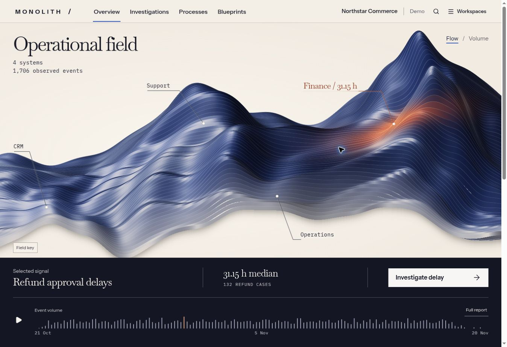
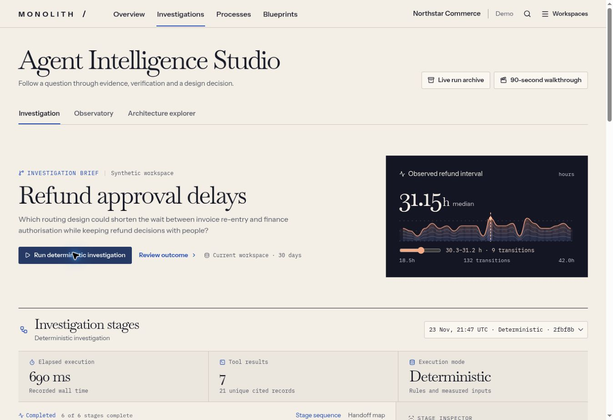
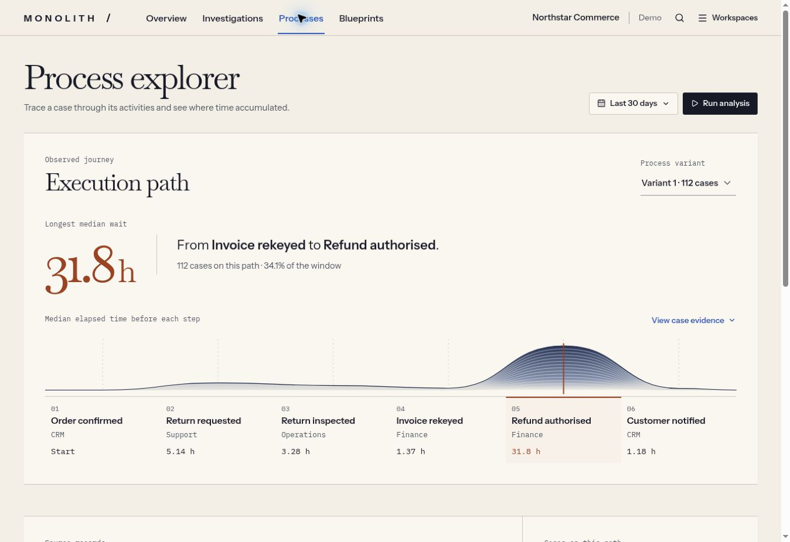
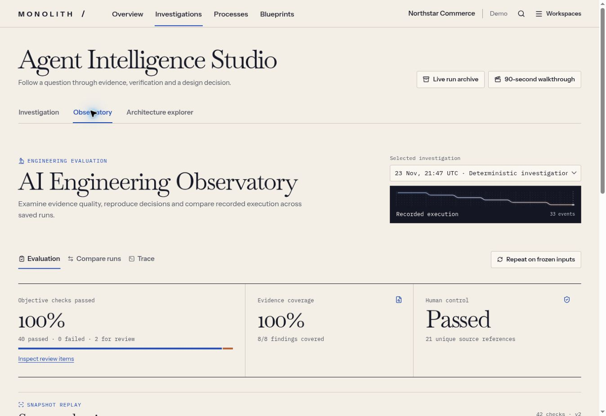
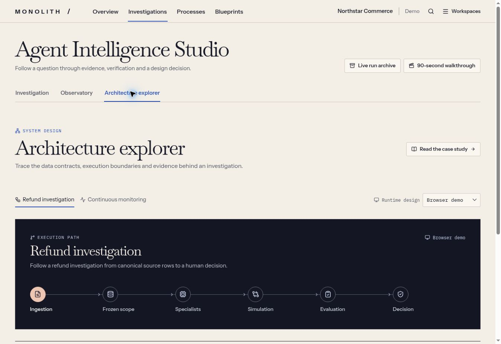

# MONOLITH workspace gallery

Actual browser captures of the Northstar synthetic showcase, taken on 23 November 2026. These are application screenshots, not design mockups. The investigation shown ran in deterministic browser mode; it made no model API calls. No client records are included.

[Repository overview](../../README.md) · [Reviewer guide](../reviewer-guide.md) · [Engineering overview](../engineering-overview.md)

## Operational field

System activity and handoffs provide the overview; the selected signal links a measured delay to the investigation workflow. The displayed 31.15-hour median is measured from synthetic refund events.

## Agent Intelligence Studio

A completed run exposes stage execution, the analysis mode, tool receipts and cited records. The current capture contains six completed stages and seven tool results with 21 unique cited records.

## Process explorer

Follow a selected process variant, inspect the longest interval and trace it to the individual events in a case. Variant-specific medians can differ from the aggregate refund median.

## AI Engineering Observatory

Objective checks are separated from interpretive review items. The completed synthetic run reports 40 objective checks passed and two items requiring review; a 100% objective-check score does not establish that every causal explanation is proven.

## Architecture explorer

Inspect inputs, outputs, invariants and implementation references for each execution boundary. Browser analysis and API deployment are distinct runtime profiles.

For competing designs, scenario assumptions and approval/export behaviour, see the [investigation guide](../refund-investigation.md). For deployment and live-provider limitations, see [release readiness](../release/readiness.md).
